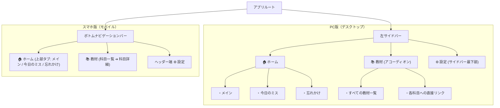
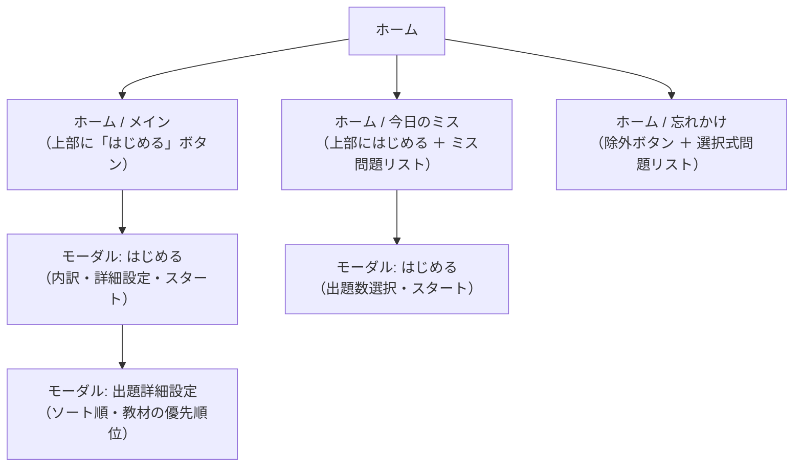
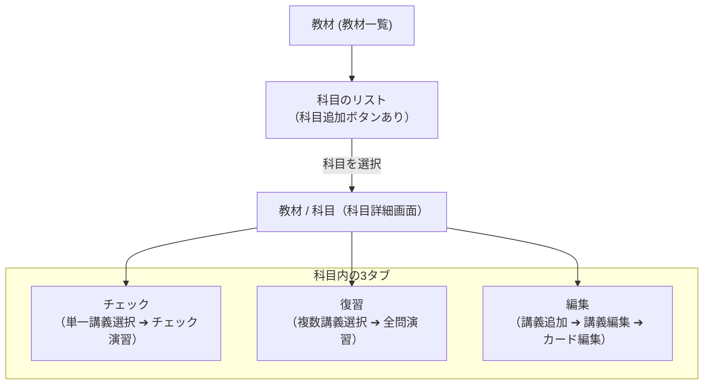

# 🎨 UI/UX 画面構成設計書

本ドキュメントは、本学習システムにおける画面レイアウト・ナビゲーション・コンポーネント構成を定義した仕様書です。

---

## 1. 全体ナビゲーション構造

大カテゴリーとして **「ホーム」** と **「教材」** の2系統を持ち、デバイスの画面サイズに応じて最適なナビゲーションを提供します。



### 1-1. デバイス別ナビゲーション配置

- **スマホ版（モバイル）:**
  - 画面最下部の **ボトムナビゲーションバー** に「🏠 ホーム」「📚 教材」を常時配置。
  - 画面上部ヘッダーの右端に「⚙ 設定」アイコンを配置。
  - 上部サブタブ（メイン / 今日のミス / 忘れかけ、チェック / 復習 / 編集）は画面幅全体を使って等間隔均等配置。
- **PC版（デスクトップ）:**
  - 画面左側の **固定サイドバー** に「🏠 ホーム」「📚 教材」を配置。
  - 「ホーム」配下には「メイン」「今日のミス」「忘れかけ」がインデントされてぶら下がる。
  - **「教材」項目はアコーディオン形式** となっており、展開時はすべての登録教材（科目）がサイドバー内に一覧表示され、ワンクリックで直接科目を切り替えることが可能。
  - サイドバー最下部に「⚙ 設定」ボタンを配置。
- **教材の閲覧状態キープ:**
  - 教材タブで最後に開いていた科目はローカルストレージに自動記憶され、ホーム等から教材タブに戻った際にその科目が開かれた状態がキープされる。

---

## 2. ホーム（Home）

日々の共通復習、直近の誤答振り返り、忘れかけカードのケアを行うダッシュボード領域です。

- **スマホ版:** 画面上部に **「メイン」「今日のミス」「忘れかけ」** の切り替えタブを画面幅全体・等間隔で配置。
- **PC版:** 左サイドバーの「ホーム」直下に子メニューとしてぶら下がり配置。
- **初期表示:** デフォルトでは **「メイン」** が開かれます。



### 2-1. ホーム / メイン

- **画面上部:**
  - **「はじめる」メインボタン**:
    - スマホ版では全幅（`w-full`）、PC版では `sm:w-auto`。
    - クリックで共通プール復習の準備モーダルを展開。
    - **出題対象カード（リベンジ・期日・先取り）が0問の場合は disabled（非活性）** となり、誤操作を防止。
- **画面中部・下部:**
  - 余計な説明テキスト等を排し、将来的な学習継続記録・統計等のためのすっきりしたスペースを確保。

#### 【モーダル】ホーム / メイン / はじめる

1. **上部: 今回出題の問題内訳**
   - 3色バッジで表示:
     - 🔁 **オレンジ（リベンジ枠）**: ○ 枚
     - 🎯 **グリーン（最適・期日到来枠）**: ○ 枚
     - ⚡ **パープル（先取り補充枠）**: ○ 枚
2. **中部: 「出題詳細設定」ボタン**
   - クリックすると出題詳細設定サブモーダルを展開。
3. **下部: 「スタート (10問マイクロセッション)」ボタン**

#### 【モーダル】ホーム / メイン / 出題詳細設定

- **出題順のソート設定（ドロップダウン）:**
  - `due順（復習期日が古い順に確実に出題）`
  - `カテゴリ内シャッフル（オレンジ・グリーンをシャッフル）`
- **教材（科目）の優先順位リスト:**
  - 各科目を一覧表示し、ラジオボタンで「強制」「優先」「通常」を設定可能。

---

### 2-2. ホーム / 今日のミス

当日（日界以降）の共通復習で間違えたカードを振り返る画面です。

- **画面上部:**
  - **「はじめる (n問)」メインボタン**:
    - スマホ版では全幅（`w-full`）、PC版では `sm:w-auto`。
    - 当日のミス問題数が0件のときは disabled。
  - **件数表示（「本日間違えた問題: n 件」）**:
    - スマホ版ではボタンの下に縦並び配置、PC版ではボタンの横に配置。
- **画面下部:**
  - 当日間違えた問題の問題文（表面）を縦リストで一覧表示。
  - パンくず（`科目名 > 講義名`）および連続ミス回数バッジ（例: `⚠️ 2連続ミス`）を表示。

#### 【モーダル】ホーム / 今日のミス / はじめる

1. **出題数のドロップダウン**:
   - `10` | `20` | `30` | `すべて`（デフォルト: `10`）
2. **「スタート」ボタン**:
   - 指定した問題数のミス問題特訓セッションを開始。

---

### 2-3. ホーム / 忘れかけ

長期間復習できず、想起維持率（$R < 0.35$）が著しく低下したカードをケアするトリアージ画面です。

- **画面上部のアクションボタン:**
  - スマホ版では全幅（`w-full`）、PC版では `sm:w-auto`。
  - 未選択時: **「すべて除外 (n件)」**
  - 選択時: **「選択した問題を除外 (n件)」**
  - 全選択 / 選択解除リンクを配置。
  - ※「除外」を実行すると、対象カードを共通プールから外し、各所属講義のプールへ **「未卒業（連続正解0）」** として戻します。
- **画面下部:**
  - 忘れかけ問題のチェックボックス付き選択可能リスト。
  - 各行に「問題文」「所属科目 ＞ 講義名」「現在の推定維持率 $R$（%）」を表示。

---

## 3. 教材（Materials）

大学の科目・講義回階層にアクセスし、新規カード作成、講義別チェック、試験直前復習、カード編集を行う領域です。



### 3-1. 教材 / （科目一覧）

- 登録されている全科目（コース）をグリッド/リスト表示。
- **シンプルな3色進捗バー:**
  - 冗長なテキストや数値を排し、**「卒業済み（エメラルド） / 現在チェック可能（アンバー） / それ以外（スレート）」** の3色プログレスバーのみを表示。
  - バーにマウスホバーした際のツールチップで各内訳の枚数を確認可能。
- 新規科目を追加する「科目を追加」ボタンを配置。

---

### 3-2. 教材 / 科目（科目詳細画面）

選択した科目の詳細画面です。画面上部に **3つのタブ（チェック / 復習 / 編集）** を画面幅全体・等間隔で配置します。

- **デフォルトタブの自動判定:**
  - **教材に問題が1問もない場合:** デフォルトで **「編集」タブ** が自動選択されます。
  - **問題が1問以上ある場合:** デフォルトで **「チェック」タブ** が選択されます。
- **問題のない講義のフィルタリング:**
  - **「チェック」タブおよび「復習」タブの講義リストには、カードが0枚の講義は出現しません**（「編集」タブにのみ表示）。

```
[← 教材一覧] 電気回路I
┌─────────────┬─────────────┬─────────────┐
│  チェック   │    復習     │    編集     │
└─────────────┴─────────────┴─────────────┘
```

#### ① 教材 / 科目 / チェック

講義ごとの短期定着確認（優先度 `3 > 2 > 1`）を実施するモードです。

- **ボタン配置:**
  - **「チェックをはじめる (n枚)」メインボタン**:
    - スマホ版では全幅（`w-full`）、PC版では `sm:w-auto`。
    - チェック対象カードが0枚のときは disabled。
- **講義リスト:**
  - カードが存在する講義のみを一覧表示。
  - クリックして1つの講義を選択（残り枚数やチェック可能/待機ロック残り時間を表示）。

#### ② 教材 / 科目 / 復習

試験前などに複数の講義をまとめて集中ループ演習するモードです。

- **ボタン配置:**
  - **「全問復習をはじめる (n講義)」メインボタン**:
    - スマホ版では全幅（`w-full`）、PC版では `sm:w-auto`。
    - 選択講義が0件のときは disabled。
  - **第二ボタン「すべて選択 / すべて選択解除」**:
    - スマホ版ではメインボタンの下に縦並び配置。
- **講義リスト:**
  - カードが存在する講義のみをチェックボックス付きでマルチセレクト表示。

#### ③ 教材 / 科目 / 編集

講義の追加・名前変更、および講義内カードの追加・編集・削除を行う管理モードです。

- **新規講義作成時の自動遷移:**
  - 「＋ 新しい講義を追加」から講義を作成した際、**自動でその作成された講義の編集画面（カード一覧画面）に移動**します。
- 各講義カードをクリックすると、その講義の編集画面（**教材 / 科目 / 編集 / 講義の編集**）が開きます。

---

### 3-3. 教材 / 科目 / 編集 / 講義の編集

特定の講義回に登録されているカードの作成・編集画面です。

- **ヘッダー & 戻る操作:**
  - 戻るボタンはテキスト説明を排し、シンプルな **矢印アイコン（←）** のみで構成。
- **カード登録機能:**
  - **「AI一括取り込み」ボタン**: クリップボードやテキスト貼り付けからAI生成カードを一括追加。
  - **「1枚ずつ追加」ボタン**: 手動入力アコーディオン/フォームを展開。
- **三点リーダードロップダウンメニュー:**
  - ✏️ **カードを編集**: カード編集モーダルを開く。
  - 🎓 **カードを卒業**: 即時共通プールへ昇格（既に卒業済みの場合は disabled）。
  - ⏸️ **カードを休止 / 再開**: 出題から一時除外（`isSuspended` トグル）。
  - 🔄 **状態をリセット**: カードの学習状態を完全初期状態（`UNATTEMPTED` / `consecutiveCorrect = 0` / `lastAttemptAt = null`）に戻す。
  - 🗑️ **カードを削除**: カードを物理削除。

---

## 4. 演習カード & 統一結果画面（リザルト画面）

### 4-1. 演習中カードのフリップUI

- **表面・裏面ともに100%不透明なソリッド背景（透過なし）** を適用。
- 3D反転時に裏面から表面の問題文が透けて読みにくくなる現象を防止するため、`transform: rotateY(...) translateZ(1px)` および `WebkitBackfaceVisibility: "hidden"` を適用し、Z軸分離と完全な不透過を実現。
- 画面上部の不要な警告バナーは削除され、パンくず（`科目名 > 講義名`）は2行化を防ぎ末尾を `...` で省略表示。

### 4-2. 統一結果画面（PracticeResultView）

ホームメイン、今日のミス、教材チェック、教材復習の **すべてのセッション終了時モーダルで統一されたUI** を表示します。

```
┌───────────────────────────────────────────┐
│ 電気回路I - 第1回 (チェック)              │
├───────────────────────────────────────────┤
│                                           │
│                  8 / 10                   │
│                                           │
│       [   次の10問 (プライマリボタン)   ] │
│                                           │
│ わからなかった (2)         [ 2問を復習 ]  │
│ ┌───────────────────────────────────────┐ │
│ │ Q. キルヒホッフの第2法則は？          │ │
│ └───────────────────────────────────────┘ │
│                                           │
│ 卒業 (1)                                  │
│ ┌───────────────────────────────────────┐ │
│ │ [☑] Q. オームの法則の公式は？         │ │
│ └───────────────────────────────────────┘ │
│                                           │
│ わかった (7)                              │
│ ┌───────────────────────────────────────┐ │
│ │ Q. 電流の単位は？                     │ │
│ └───────────────────────────────────────┘ │
│                                           │
│              [  終了する  ]               │
└───────────────────────────────────────────┘
```

1. **ヘッダー:** 取り組んだ演習のタイトルのみを表示。
2. **メインスコア:** 上部に大きく **`正解数 / 問題数 (n / m)`** を表示。
3. **動的プライマリメインボタン:**
   - **ホーム / メイン:** 「次の10問」
   - **ホーム / 今日のミス:**
     - ミスしたまま終わっているカードがある場合: 「次の10問 (残りn問)」
     - すべて正解した場合: 「2周目開始 (10問)」
   - **教材 / チェック:**
     - 同じ講義内にまだチェック対象がある場合: 「次の10問」
     - 科目内の他の講義にチェック対象がある場合: 「{講義名}のチェックを開始（n問）」
     - どちらもない場合: 「完了」
   - **教材 / 復習:** 「次の10問」
4. **問題リスト（3セクション）:**
   - **わからなかった (n):** 不正解問題一覧。右端に「n問を復習」ボタンを配置。
   - **卒業 (x):** ※教材チェック時のみ表示。今回新しく卒業対象（卒業推奨）となったカード一覧。タップでチェックをON/OFFでき、画面下部のボタンが「n問を卒業」に変化。
   - **わかった (m):** 正解した問題一覧。
5. **画面下部:** 固定の「終了する」（または「n問を卒業」）ボタン。

---

## 5. レスポンシブ & ボタン仕様まとめ

| 画面・コンポーネント          | PC版（デスクトップ）                                   | スマホ版（モバイル）                                           |
| :---------------------------- | :----------------------------------------------------- | :------------------------------------------------------------- |
| **全体ナビゲーション**        | 固定サイドバー（アコーディオン式教材ツリー）           | ボトムナビゲーションバー                                       |
| **上部サブタブ**              | 左サイドバーのサブメニュー                             | 画面幅いっぱいを使った等間隔均等配置                           |
| **メインボタン**              | `sm:w-auto`（自動幅）、`px-6 py-3 rounded-xl`          | `w-full`（全幅）、`px-6 py-3 rounded-xl`                       |
| **同一行UIの配置**            | ボタンと同一行に横並び                                 | ボタン全幅化に伴い **縦並び** に配置                           |
| **設定画面（SettingsModal）** | 左右2列で配置                                          | 説明文と操作コントロール（ボタン・セレクト）を **縦並び** 配置 |
| **演習・復習プレイヤー**      | 画面中央にカード配置（キーボード Space/矢印 フル対応） | 画面中央にカード配置（タップ操作、不透過フリップカード）       |
