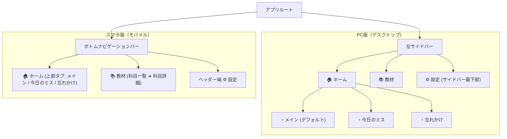
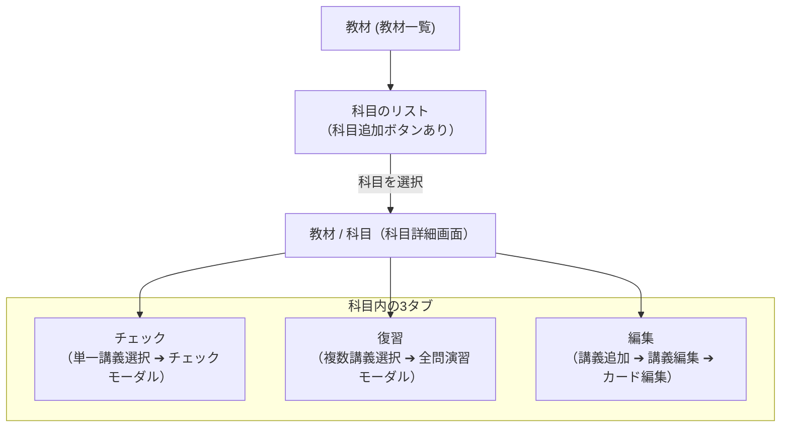

# 🎨 UI/UX 画面構成設計書

本ドキュメントは、本学習システムにおける新しい画面レイアウト・ナビゲーション・コンポーネント構成を定義した仕様書です。

---

## 1. 全体ナビゲーション構造

大カテゴリーとして **「ホーム」** と **「教材」** の2系統を持ち、デバイスの画面サイズに応じて最適なナビゲーションを提供します。



### 1-1. デバイス別ナビゲーション配置

- **スマホ版（モバイル）:**
  - 画面最下部の **ボトムナビゲーションバー** に「🏠 ホーム」「📚 教材」を常時配置。
  - 右上ヘッダー端に「⚙ 設定」アイコンを配置。
- **PC版（デスクトップ）:**
  - 画面左側の **固定サイドバー** に「🏠 ホーム」「📚 教材」を配置。
  - 「ホーム」配下には「メイン」「今日のミス」「忘れかけ」がインデントされてぶら下がる。
  - サイドバー最下部に「⚙ 設定」リンク/ボタンを配置。

---

## 2. ホーム（Home）

日々の共通復習、直近の誤答振り返り、忘れかけカードのケアを行うダッシュボード領域です。

- **スマホ版:** 画面上部に **「メイン」「今日のミス」「忘れかけ」** の切り替えタブを配置。
- **PC版:** 左サイドバーの「ホーム」直下に子メニューとしてぶら下がり配置。
- **初期表示:** デフォルトでは **「メイン」** が開かれます。


### 2-1. ホーム / メイン

将来的なマイルストーンや学習継続モチベーションUIを配置するためのスペースを広く確保したシンプルな画面構成です。

- **画面上部:**
  - **「はじめる」ボタン**: クリックで共通プール復習の準備モーダルを展開。
- **画面中部・下部:**
  - （将来的な学習継続記録・ストリーク・統計グラフ等のための予約スペース）

#### 【モーダル】ホーム / メイン / はじめる

「はじめる」ボタンを押した際に展開するセッション前確認モーダルです。

1. **上部: 今回出題の問題内訳**
   - 3色バッジで表示:
     - 🔁 **オレンジ（リベンジ枠）**: ○ 枚
     - 🎯 **グリーン（最適・期日到来枠）**: ○ 枚
     - ⚡ **パープル（先取り補充枠）**: ○ 枚
2. **中部: 「詳細設定」ボタン**
   - クリックすると「詳細設定」モーダルを展開。
3. **下部: 「スタート」ボタン**
   - 共通プールの10問マイクロセッション（FSRS連動）を開始。

#### 【モーダル】ホーム / メイン / はじめる / 詳細設定

- **出題順のソート設定（ドロップダウン）:**
  - `due順（期日が古い順に復習）`
  - `カテゴリ内シャッフル（オレンジ・グリーンをシャッフル、パープルはdue順）`
- **教材（科目）の優先順位リスト:**
  - 各科目を行として縦にリスト表示。
  - 右側に横並びのラジオボタンを配置:
    ```
    [科目名]         ( ) 強制    ( ) 優先    ( ) 通常
    電気回路I        ( ) 強制    (●) 優先    ( ) 通常
    線形代数         (●) 強制    ( ) 優先    ( ) 通常
    データ構造とAlt   ( ) 強制    ( ) 優先    (●) 通常
    ```

---

### 2-2. ホーム / 今日のミス

当日（午前04:00以降）の共通復習で間違えたカードを振り返る画面です。

- **画面上部:**
  - **「はじめる」ボタン**: 間違えたカードに絞った集中リベンジ演習モーダルを展開。
- **画面下部:**
  - 当日間違えた問題の問題文（表面）を縦リストで一覧表示。
  - 連続ミス回数バッジ（例: `⚠️ 2連続ミス`）を表示。

#### 【モーダル】ホーム / 今日のミス / はじめる

1. **上部:** 余白スペース（将来の拡張用）。
2. **中部: 出題数のドロップダウン**
   - 選択肢: `10` | `20` | `30` | `すべて`（デフォルト: `10`）
3. **下部: 「スタート」ボタン**
   - 指定した問題数のミス問題特訓セッションを開始。

---

### 2-3. ホーム / 忘れかけ

長期間復習できず、想起維持率（$R < 0.35$）が著しく低下した瀕死カードをケアする画面です。

- **画面上部のアクションボタン:**
  - 通常時（未選択時）: **「すべて除外」ボタン**
  - リストで1件以上選択時: **「選択した問題を除外」ボタン**
  - ※「除外」を実行すると、対象カードを共通プールから外し、各所属講義のプールへ **「未卒業（連続正解0）」として戻します**（講義プールで再度チェックを受けられる状態にする）。
- **画面下部:**
  - 忘れかけ問題のチェックボックス付き選択可能リスト。
  - 各行に「問題文」「所属科目 ＞ 講義名」「現在の推定維持率 $R$（%）」を表示。

---

## 3. 教材（Materials）

大学の科目・講義回階層にアクセスし、新規カード作成、講義別チェック、試験直前復習、カード編集を行う領域です。



### 3-1. 教材 / （科目一覧）

- 登録されている全科目（コース）のカード/リストを表示。
- 科目名、所属する講義数、卒業済みカード数・未卒業カード数などの進捗を表示。
- 新規科目を追加するボタンを配置。
- 科目をクリックすると **「教材 / 科目」** 画面へ遷移。
- **PC版ナビゲーション:** 科目選択後、左サイドバー上部に「← 教材一覧 / {科目名}」のパンくず・戻るボタンが表示され、ワンクリックで科目一覧に戻ることが可能。

---

### 3-2. 教材 / 科目

選択した科目の詳細画面です。画面上部に **3つのタブ（チェック / 復習 / 編集）** を配置し、下部にその科目に属する講義一覧を表示します。

```
[← 教材一覧] 電気回路I
┌─────────────┬─────────────┬─────────────┐
│  チェック   │    復習     │    編集     │
└─────────────┴─────────────┴─────────────┘
```

#### ① 教材 / 科目 / チェック

講義ごとの短期定着確認（優先度 `3 > 2 > 1`）を実施するモードです。

- **操作・選択:**
  - 下部の講義リストから **1つの講義をクリックして単一選択**。
- **ボタン配置:**
  - タブの下、講義リストの上に **「はじめる」ボタン** を配置（未選択時は非活性）。
- **【モーダル】教材 / 科目 / チェック / はじめる:**
  - 選択された講義のチェック対象カード（③8h経過定着 ＞ ②未実施 ＞ ①連続正解0）を出題するモーダル。
  - 下部に **「スタート」ボタン** を配置。
  - 回答結果に応じて `consecutiveCorrect`、`lastAttemptAt`、`phase`（未実施 ➔ 未卒業 ➔ 卒業推奨）が正しく更新される。

#### ② 教材 / 科目 / 復習

試験前などに複数の講義をまとめて集中ループ演習するモードです。

- **操作・選択:**
  - 下部の講義リストをクリックして **複数選択（マルチセレクト・チェックボックス）**。
- **ボタン配置:**
  - タブの下、講義リストの上に **「はじめる」ボタン** を配置。
  - その直下に **第二ボタン「すべて選択 / すべて選択解除」** を配置。
- **【モーダル】教材 / 科目 / 復習 / はじめる:**
  - 選択された複数講義の全カード（休止中を除く）を合算し、シャッフルして出題する自由演習モーダル。
  - 下部に **「スタート」ボタン** を配置。
  - ※自由演習のためカードのステータスやFSRSパラメータは汚染・変更されません。

#### ③ 教材 / 科目 / 編集

講義の追加・名前変更、および講義内カードの追加・編集・削除を行う管理モードです。

- **講義リスト:**
  - リストの一番上に **「＋ 新しい講義を追加」** ボタンを配置。
  - 各講義をクリックすると、その講義の編集画面（**教材 / 科目 / 編集 / 講義の編集**）が開く。

---

### 3-3. 教材 / 科目 / 編集 / 講義の編集

特定の講義回に登録されているカードの作成・編集画面です。

```
[← 科目へ戻る] 第1回 オームの法則
[✨ AI一括取り込み]
[＋ 1枚ずつ追加]

【問題リスト】
1. オームの法則の公式は？              [︙]
2. 抵抗の単位は？                      [︙]
```

1. **上部ボタン群:**
   - **「AI一括取り込み」ボタン**: クリップボードやテキスト貼り付けからAI生成カードを一括追加するモーダルを開く。
   - **「1枚ずつ追加」ボタン**: 手動入力アコーディオン/フォームを展開。
2. **問題リスト:**
   - 登録カードが縦に一覧表示される。
   - 各カード行の右端に **三点リーダーボタン（︙）** を配置。
3. **三点リーダードロップダウンメニュー:**
   - ✏️ **カードを編集**: カード編集モーダルを開く。
   - ⏸️ **カードを休止 / 再開**: 出題から一時除外（`isSuspended` トグル）。
   - 🔄 **状態をリセット**: カードの学習状態を完全初期状態（`UNATTEMPTED` / `consecutiveCorrect = 0` / `lastAttemptAt = null`）に戻す。
   - 🗑️ **カードを削除**: 確認ダイアログ後にカードを物理削除。

#### 【モーダル】教材 / 科目 / 編集 / 講義の編集 / カードの編集

- **上部:** 問題の入力フォーム（表面・テキストエリア）
- **中部:** 答えの入力フォーム（裏面・テキストエリア）
- **下部:** **「編集を保存」ボタン**（および「キャンセル」ボタン）

---

## 4. レスポンシブ & UIコンポーネント対応表

| 画面・機能                   | PC版（デスクトップ）                                   | スマホ版（モバイル）                                       |
| :--------------------------- | :----------------------------------------------------- | :--------------------------------------------------------- |
| **全体ナビゲーション**       | 左サイドバー（幅 240px 程度）                          | 画面最下部ボトムナビゲーションバー（高さ 56px）            |
| **設定（Settings）**         | 左サイドバー最下部に常時表示                           | ヘッダー右上にギアアイコン配置                             |
| **ホーム内切り替え**         | 左サイドバーの「ホーム」下ツリー展開                   | ホーム画面最上部のタブ切り替え                             |
| **教材内の科目詳細切り替え** | サイドバー上部パンくずで一覧復帰可能                   | 画面ヘッダー左の「← 戻る」アイコン                         |
| **演習・復習プレイヤー**     | 画面中央にカード配置（キーボード Space/矢印 フル対応） | 画面中央にカード配置（フルスクリーンモーダル、タップ操作） |

---

## 5. 状態遷移とアクションまとめ

1. **ホーム / メイン:**
   - `はじめる` ➔ 内訳確認・ソート・優先順位確認 ➔ `スタート` ➔ 共通復習（10問バッチ）
2. **ホーム / 今日のミス:**
   - 当日ミス一覧表示 ➔ `はじめる` ➔ 出題数（10/20/30/すべて）選択 ➔ リベンジ特訓開始
3. **ホーム / 忘れかけ:**
   - $R < 0.35$ 一覧表示 ➔ チェックボックス選択 ➔ `選択した問題を除外`（または `すべて除外`）➔ 所属講義プールへ未卒業として降格
4. **教材 / 科目 / チェック:**
   - 講義単一選択 ➔ `はじめる` ➔ チェックモード（優先度3>2>1）
5. **教材 / 科目 / 復習:**
   - 講義複数選択（すべて選択可能） ➔ `はじめる` ➔ 全問自由演習（シャッフル）
6. **教材 / 科目 / 編集:**
   - 講義追加 / 講義選択 ➔ 一括取り込み or 1枚追加 ➔ 三点リーダーから編集・休止・リセット・削除
